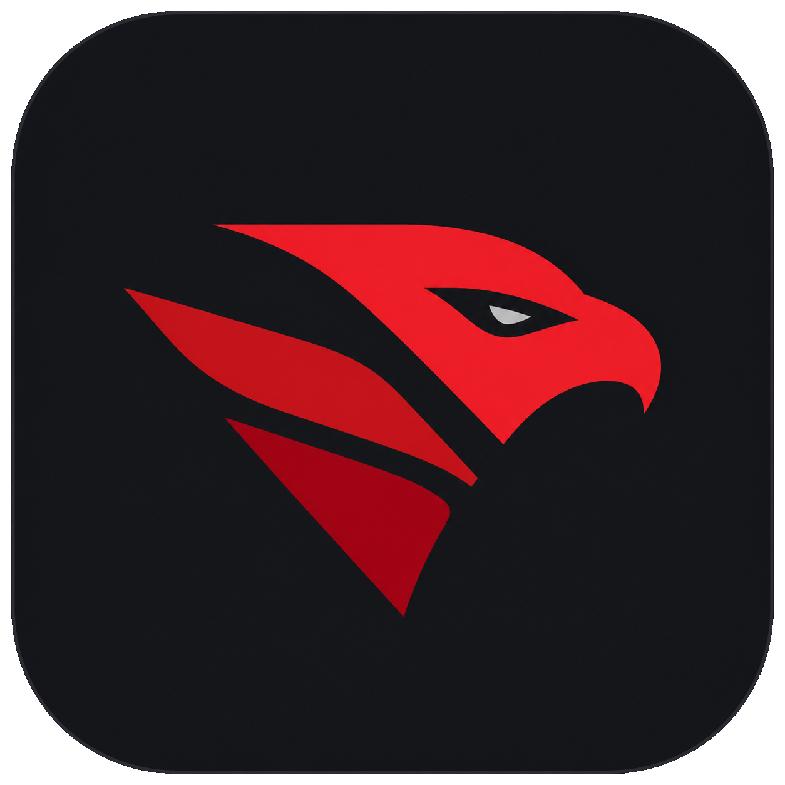
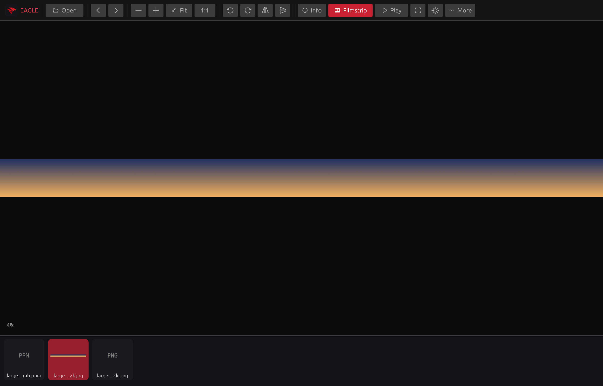
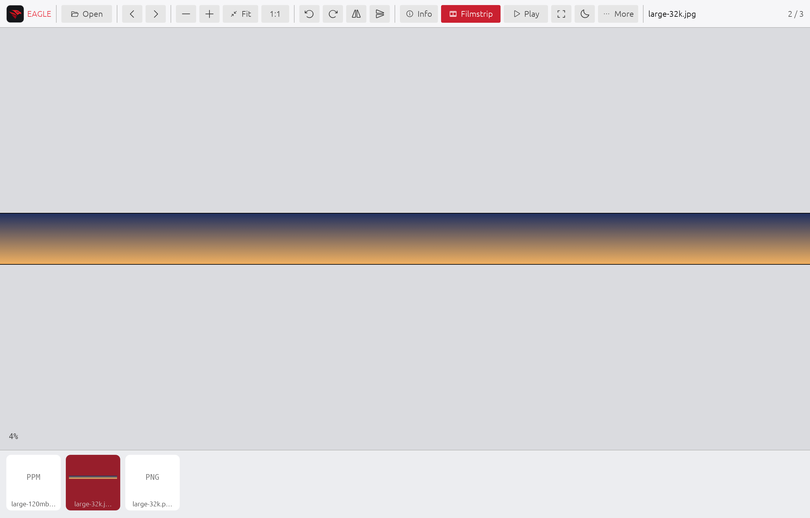

<p align="center">
  
</p>

<h1 align="center">Eagle Viewer</h1>

<p align="center">
  A GPU-first, Rust-native image viewer for macOS, engineered for instant navigation and very large images.
</p>

<p align="center">
  <a href="https://github.com/rgcsekaraa/eagle-viewer/actions/workflows/ci.yml"></a>
  <a href="LICENSE"></a>
  
  
</p>

## Preview

| Dark appearance | Light appearance |
|---|---|
|  |  |

Eagle Viewer follows the current macOS appearance on launch. Press `T` or use the sun button to switch instantly.

## Highlights

- Metal-backed rendering through `wgpu` and `egui`
- Reduced-IDCT JPEG previews and row-streamed PNG previews capped at 4096 pixels
- Lazy, SSD-backed full-resolution rasters with visible 512-pixel GPU tiles
- Latest-request-first background decoding with stale-result rejection
- Immediate previous/current/next preview working set with a byte-bounded 512 MiB CPU/GPU cache
- Persistent Open Recent history, folder filmstrip, timed slideshow and image information
- Zoom, pointer-centred pan, rotate, flip, reset and transparency-friendly canvas backgrounds
- Embedded-preview-first camera RAW support, including Sony ARW
- macOS-native Quick Look fallback for formats such as HEIC, AVIF, PSD and SVG
- Dark and light appearances with a consistent red/graphite identity
- Font-independent vector toolbar icons and immediate tooltips
- Complete keyboard access for viewer and file actions

## Format support

| Family | Formats |
|---|---|
| Common raster | JPEG, PNG, WebP, TIFF, GIF, BMP, ICO, QOI, TGA, PNM/PPM/PGM |
| HDR | OpenEXR, Radiance HDR |
| Camera RAW | ARW, CR2, CR3, NEF, NRW, DNG, RAF, RW2, ORF, PEF, SRW, X3F, 3FR and more |
| macOS fallback | HEIC/HEIF, AVIF, PSD/PSB, JPEG 2000, ICNS, SVG, PICT and other Quick Look-compatible images |

RAW files are opened from their embedded developed preview first. Support for a native fallback format depends on the codecs available in the installed macOS version. See [docs/FORMATS.md](docs/FORMATS.md) for implementation details and limitations.

## Install from source

Requirements:

- macOS 12 Monterey or newer
- Stable Rust toolchain
- Xcode Command Line Tools

```sh
git clone https://github.com/rgcsekaraa/eagle-viewer.git
cd eagle-viewer
./scripts/bundle.sh
open "target/release/bundle/osx/Eagle Viewer.app"
```

The bundle is ad-hoc signed for local use. A downloaded release may require the usual macOS confirmation until a notarized distribution is available.

To run without creating an application bundle:

```sh
cargo run --release -- "/path/to/image.jpg"
```

## Keyboard controls

| Shortcut | Action |
|---|---|
| `Cmd+O` | Open an image |
| `Cmd+Shift+O` | Reopen the most recent image |
| `Left Arrow` / `Right Arrow` | Previous / next image |
| `Home` / `End` | First / last image |
| `0` | Fit image to the window |
| `1` | Show actual pixels (100%) |
| `+` / `-` | Zoom in / out |
| Mouse wheel / trackpad scroll | Zoom around the pointer |
| Trackpad pinch | Native cursor-centred zoom |
| Primary or middle-button drag | Pan immediately |
| Double-click | Fit image to the window |
| `R` / `Shift+R` | Rotate clockwise / counterclockwise |
| `H` / `V` | Flip horizontally / vertically |
| `I` | Toggle image information |
| `B` | Toggle the filmstrip |
| `Space` | Play or pause the slideshow |
| `F` | Toggle fullscreen |
| `Escape` | Leave fullscreen |
| `T` | Toggle light/dark appearance |
| `G` | Cycle automatic, black, white and checkerboard canvas backgrounds |
| `X` | Reset view, rotation and flips |
| `[` / `]` | Slower / faster slideshow timing |
| `Cmd+Shift+C` | Copy the current file path |
| `Cmd+Shift+R` | Reveal the current file in Finder |
| `Cmd+Shift+S` | Save a copy of the current file |

## Performance model

The UI thread never performs image decoding. A 4096-pixel preview is produced first, and exactly the immediate previous and next reduced previews are prefetched around the current image. This three-image working set makes arrow-key navigation immediate without decoding three full-resolution images. Full detail remains current-image-only and is built only when zoom requires more pixels. Huge JPEG and non-interlaced PNG images are decoded into temporary memory-mapped files so the operating system can page data through the SSD. Only visible tiles are uploaded to the GPU.

On the development machine, the included benchmark path measured a 32,000 x 2,000 JPEG at approximately 119 ms for its first 4096-pixel preview and 403 ms for the full 183 MiB SSD-backed raster. Hardware, storage, codec and image content all affect results.

```sh
cargo build --release
target/release/eagle-viewer --bench-preview "/path/to/large-image.jpg"
target/release/eagle-viewer --bench-detail "/path/to/large-image.jpg"
```

## Architecture

The project intentionally keeps the hot path small:

- `src/loader.rs` owns preview decoding and background job priority.
- `src/detail.rs` owns SSD-backed full-detail decoding and tile extraction.
- `src/cache.rs` enforces the preview memory budget.
- `src/catalog.rs` indexes supported images in the current folder.
- `src/view.rs` handles inertial zoom/pan transforms.
- `src/app.rs` owns UI state and GPU texture presentation.

See [docs/ARCHITECTURE.md](docs/ARCHITECTURE.md) for the full data flow.

## Card Scout companion

The repository also includes Card Scout, a small macOS utility that identifies processes holding files open on removable camera media before ejecting it.

```sh
./scripts/bundle-card-scout.sh
open "target/release/bundle/osx/Card Scout.app"
```

## Contributing

Issues and pull requests are welcome. Start with [CONTRIBUTING.md](CONTRIBUTING.md), follow the [Code of Conduct](CODE_OF_CONDUCT.md), and report security concerns through the process in [SECURITY.md](SECURITY.md).

Toolbar symbols use [Phosphor Icons](https://phosphoricons.com/), distributed under the MIT License through `egui-phosphor`. See [THIRD_PARTY_LICENSES.md](THIRD_PARTY_LICENSES.md).

## License

Eagle Viewer is available under the [MIT License](LICENSE).
